 

---

### `> whoami`

I build **mobile apps and the backends behind them** — from the first API route to the signed build that passes App Store review.

- 📱 **Shipped to production:** rider, driver and partner apps on **Google Play & the App Store** (React Native · Flutter) as an SDE Intern at **Dendo**.
- 🧱 **End-to-end:** Node.js, Spring Boot and Laravel APIs, PostgreSQL/MySQL, WebSockets, FCM push, Google Maps, payments, CI/CD with Fastlane.
- 🏆 **1st place**, Shardeum track — *Hack with GDG Season 3* (36-hour hackathon, Feb 2026).
- 🎓 B.E. CSE (IoT), Sri Krishna College of Technology · **CGPA 8.4** · department rank 2 · **300+ LeetCode** problems.

---

### 💼 Experience

<table>
<tr>
<td width="72"></td>
<td>

**Software Development Engineer Intern — Dendo**, Coimbatore · *Jul 2026 – Sep 2026*

Two live platforms, four store apps: **NexaRide** (ride-hailing — rider & driver apps) and **Dendo** (food delivery — customer & restaurant-partner apps).

- Built NexaRide rider/driver apps in **React Native** on **Node.js** services with real-time trip updates, live map tracking and lock-screen trip status.
- Built **Flutter** partner features on a **Laravel** REST backend: live orders with alerts, rider tracking, chat, store status, tax invoices, settlements and Bluetooth receipt printing.
- Integrated **FCM** notifications and Google / Apple / Facebook sign-in; cut a dashboard freeze by lazy-rendering orders and dropping ~10 MB of assets.
- Owned **releases with Fastlane** — signed AAB / iOS builds, store listings, review submissions and Play policy fixes.

</td>
</tr>
</table>

---

### 🚀 Featured work

<table>
<tr>
<td width="50%" valign="top">

#### 🛡️ [TrustLance](https://github.com/kingprem12/TrustLance_TRT) &nbsp;`🏆 GDG winner`
Freelance marketplace where every milestone is paid from a **Solidity escrow** on Shardeum. Wallet sign-in, Supabase with row-level security, Gemini-assisted dispute summaries.

`Next.js` `TypeScript` `Solidity` `Hardhat` `Supabase`

</td>
<td width="50%" valign="top">

#### 🌾 [AgriShield-X](https://github.com/kingprem12/Agri-Shield)
Next-month **drought forecasting** from 1.36 M satellite records (MODIS, CHIRPS, ERA5). PSO-tuned LightGBM, R² 0.82 — plus an [ESP32 field-sensor edition](https://github.com/kingprem12/Agri-shield--X).

`Python` `LightGBM` `Earth Engine` `Docker` `Terraform` `ESP32`

</td>
</tr>
<tr>
<td width="50%" valign="top">

#### 🤖 JARVIS &nbsp;`private`
Self-hosted AI operator: streaming chat, sandboxed tools, approvals with diffs, semantic memory, browser and developer agents, voice and a mobile companion.

`TypeScript` `Fastify` `React` `PostgreSQL` `Ollama`

</td>
<td width="50%" valign="top">

#### 🧿 Aegis — Cyber Defense Lab &nbsp;`private`
Local-first SOC: detects activity in a simulated enterprise, investigates with local AI agents and proposes reversible responses behind human approval. **391 tests.**

`Python` `FastAPI` `React` `PostgreSQL` `Redis` `Docker` `Ollama`

</td>
</tr>
<tr>
<td width="50%" valign="top">

#### 💼 [JobTracker](https://github.com/kingprem12/job-tracker-management-)
Job and interview management with role-based access for candidates, counselors and admins. Spring Boot serves the API and the React SPA from one port.

`Java` `Spring Boot 3.5` `React 18` `JWT`

</td>
<td width="50%" valign="top">

#### 🐍 [Slytherin DEX](https://github.com/kingprem12/Slytherin)
"Stripe for swaps" — an API-only AMM on **Algorand**, so any wallet or fintech app can offer token swaps with one call. ~3.5 s finality.

`TypeScript` `Algorand` `PuyaTS` `REST`

</td>
</tr>
<tr>
<td width="50%" valign="top">

#### 🏦 [Loanify](https://github.com/kingprem12/loanify)
NBFC loan automation with multi-agent orchestration — KYC, sales, underwriting and document agents — plus a live admin dashboard.

`TypeScript` `Python` `Java` `AI agents`

</td>
<td width="50%" valign="top">

#### 👻 [Ghost Yield](https://github.com/kingprem12/Ghost_Yield)
DeFi vault on an Initia rollup with session auto-signing, so a "ghost operator" can compound yield without a popup per transaction.

`Solidity` `TypeScript` `Initia`

</td>
</tr>
</table>

More: [Law-Craftsmen](https://github.com/kingprem12/Law-Craftsmen) (legal RAG assistant) · [Private-chatbot](https://github.com/kingprem12/Private-chatbot) (offline document Q&A with Ollama) · [Retro-Kitchen](https://github.com/kingprem12/Retro-Kitchen) · [Fridge Gourmet](https://fridge-gourment.vercel.app) · [Competitive-Program](https://github.com/kingprem12/Competitive-Program)

---

### 🧰 Tech stack

<table>
<tr><td><b>Mobile</b></td><td></td></tr>
<tr><td><b>Frontend</b></td><td></td></tr>
<tr><td><b>Backend</b></td><td></td></tr>
<tr><td><b>Data</b></td><td></td></tr>
<tr><td><b>Cloud & DevOps</b></td><td></td></tr>
<tr><td><b>Web3 & IoT</b></td><td></td></tr>
</table>

---

### 📜 Certifications

| | Certification | Issuer | Year |
|:-:|---|---|:-:|
|  | **Microsoft Certified: Azure Fundamentals** | Microsoft | 2025 |
|  | AWS Cloud Practitioner Essentials | AWS Skill Builder | 2025 |
|  | Software Engineering Job Simulation (Kafka, REST, H2) | JPMorgan Chase · Forage | 2026 |
|  | Technology · Cyber · Data Analytics Job Simulations | Deloitte · Forage | 2026 |
|  | Technology Risk Job Simulation | EY · Forage | 2026 |
|  | Python Essentials 1 & 2 | Cisco Networking Academy | 2026 |
|  | Introduction to Cybersecurity | Cisco Networking Academy | 2024 |
|  | ReactJS | Infosys Springboard | 2024 |

---

### 🏆 Highlights

- 🥇 **1st place, Shardeum track** — Hack with GDG Season 3, GDG KSRCE (Feb 2026)
- 🥈 **2nd place** — Unstop hackathon, Bharati Vidyapeeth University (AI micro-port export model)
- 📄 **Research paper** — AgriShield-X drought forecasting (IEEE conference format)
- 🎖️ **Department rank 2** in CSE (IoT), 2024–25 and 2025–26

---

  

<picture>
  <source media="(prefers-color-scheme: dark)" srcset="https://raw.githubusercontent.com/kingprem12/kingprem12/output/snake-dark.svg"/>
  <source media="(prefers-color-scheme: light)" srcset="https://raw.githubusercontent.com/kingprem12/kingprem12/output/snake.svg"/>
  
</picture>

Built with care in Coimbatore · let's build something that ships.

